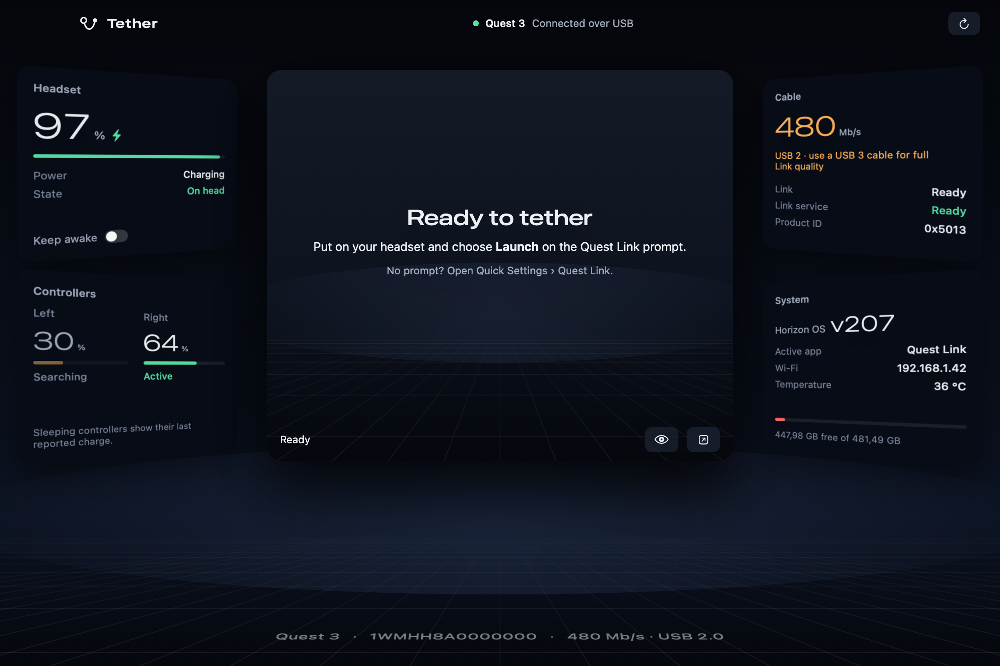

# Tether

Quest Link for the Mac, over USB.

Tether turns an Apple silicon Mac into a Link PC for a Quest headset. Plug the headset in with a USB‑C cable, choose **Launch** on the headset's own Quest Link prompt, and you're in: your Mac desktop in VR, or your Unity scene in Play mode. Nothing is installed on the headset. Tether speaks the same USB protocol (XRSP) as the Windows Link app, so the headset's built‑in Link client does the rest.



## Features

- **Native Link over USB.** Tether pairs with the headset automatically and shows up on its Quest Link prompt. No sideloaded APK, no Wi‑Fi streaming app.
- **Your Mac desktop in VR.** The desktop is shown on a large screen in a quiet room. Point a controller at the screen to move the pointer. The trigger clicks and drags, so you can move windows around.
- **Unity and Unreal.** Press Play in Unity or VR Preview in Unreal, and the scene renders into the headset with head and controller tracking. Nothing to set up: Tether registers its OpenXR runtime and installs its Unreal plugin.
- **Meta button:** hold it to recenter the view. Short‑press it to open the End Link panel, which ends the session and returns the headset to Home.
- **Headset dashboard.** Shows battery, controllers, whether the headset is worn, OS, storage and USB speed, plus a live mirror of the headset's display. The dashboard and mirror need USB debugging.
- **Menu bar and island.** A compact status island at the top of the screen, a menu bar item, and Open at Login. Tether starts by itself when you connect the headset.

## Requirements

- An Apple silicon Mac with macOS 27 or later
- Quest 3 or Quest 2. Tested on Quest 3 with Horizon OS v207.
- A USB‑C cable that carries data, connected directly to the Mac
- Optional, for the dashboard and display mirror: developer mode on the headset and `adb` (`brew install android-platform-tools`)

## Install

### Download

Get `Tether.zip` from [Releases](../../releases), unzip it and move **Tether.app** to `/Applications`.

The release build isn't notarized, so the first time you open it macOS will refuse. Open **System Settings › Privacy & Security** and click **Open Anyway**. You can also run:

```sh
xattr -dr com.apple.quarantine /Applications/Tether.app
```

### Build from source

You need Xcode 27 (Swift 6.4) and Homebrew's libusb:

```sh
brew install libusb
git clone https://github.com/GameBayoumy/tether.git
cd tether
./scripts/bundle.sh          # builds build/Tether.app
cp -R build/Tether.app /Applications/
```

`bundle.sh` signs the app with your Apple Development or Developer ID certificate if you have one, and ad‑hoc otherwise. Ad‑hoc signatures change on every build, so macOS will ask for Screen Recording and Accessibility permission again after each rebuild.

## Use

1. Open Tether and connect the headset.
2. Put the headset on. When the **Quest Link** prompt appears, choose **Launch**. If no prompt appears, open Quick Settings › Quest Link.
3. The first time, allow Tether to use **Screen & System Audio Recording**, so it can show your desktop. To use the controllers as a pointer, also allow **Accessibility**.

In the headset:

| Control | Action |
| --- | --- |
| Point at the screen | Move the Mac pointer |
| Trigger | Click and drag |
| Hold the Meta button | Recenter the view |
| Short-press the Meta button | Open the End Link panel |

## Unity

Tether ships an OpenXR runtime and makes it the Mac's default OpenXR runtime. The first time Tether runs, macOS asks for your password once. With that done, a Unity project that uses OpenXR works as it is. Start from Unity's VR template, or enable **OpenXR** for macOS under **Project Settings › XR Plug‑in Management**. Then start Link in the headset and press **Play**.

While Unity is rendering, Tether passes its frames straight to the headset. The Meta button still works: the End Link panel takes over the display while it's open.

## Unreal Engine

Tether installs its [TetherXR plugin](https://github.com/GameBayoumy/tether-unreal) into every Unreal Engine the Epic Games Launcher has installed, and keeps it up to date. Builds for UE 5.8 and 5.3 are included. Open a VR project, start Link in the headset and click **VR Preview**. C++ projects pick up the plugin on their next build. Unreal support is new; please report anything that looks off.

## How it works

```
 Quest (built-in Link client)  ◀── USB / XRSP ──▶  Tether.app ◀── socket + shared memory ──▶  OpenXR app
                                                  │                                            (Unity editor)
                                                  ├─ pairing, session, tracking, input
                                                  ├─ Metal renderer + ScreenCaptureKit
                                                  └─ VideoToolbox H.264 (5 slices per frame)
```

- **`Sources/CXRSP`**: the USB host. It contains [libxrsp](Sources/CXRSP/LICENSE-libxrsp) and `link_host.c`, which handles pairing, the streaming session, pose and input decoding, the headset clock, and frame timing.
- **`Sources/TetherCore`**: per‑slice H.264 encoding, shared by the app and the runtime. The headset decodes each 3616×1920 frame as five independent Baseline slices.
- **`Sources/Tether`**: the app, built with SwiftUI. It contains the dashboard, desktop renderer, controller pointer, island and menu bar.
- **`Sources/TetherOpenXR`**: the OpenXR runtime (`libTetherOpenXR.dylib`). It reads tracking from shared memory written by the app, encodes the app's frames, and hands them to Tether to send. It also exports a small C API ([`tether_direct.h`](Sources/CXRSP/include/tether_direct.h)) that the Unreal plugin uses.

### Development switches

| Variable | Effect |
| --- | --- |
| `TETHER_DEV_SKIP_PAIRING=1` | Skip the Launch prompt and start the headset client over adb |
| `TETHER_DUMP_TOPICS=<dir>` | Record incoming XRSP topics |
| `TETHER_DUMP_POSES=<dir>` | Save a sample of pose messages |
| `TETHER_DUMP_SLICE=<file>` | Write slice 0 of the first frames as Annex‑B H.264 |

`Tether --snapshot <dir>` renders the app's screens to PNG files.

## Limitations

- Video only: no audio and no microphone yet.
- USB only. Air Link isn't supported.
- Controllers only; no hand tracking.
- The protocol was worked out by observing a working Link session. A headset software update can break Tether.

## Credits

- [libxrsp](https://github.com/veygax/libxrsp) by Evan Lambert (MIT)
- Max Thomas's [`quest_link` driver for Monado](https://github.com/shinyquagsire23/monado), the first open description of XRSP
- [OpenXR SDK](https://github.com/KhronosGroup/OpenXR-SDK) headers (Apache 2.0)
- [libusb](https://libusb.info) (LGPL 2.1), linked statically

## License

MIT. See [LICENSE](LICENSE).

Tether is an independent project. It isn't affiliated with, endorsed by or sponsored by Meta Platforms, Inc. Meta Quest and Quest Link are trademarks of Meta Platforms, Inc., named here only to describe compatibility.
